# 📦 ระบบบริหารจัดการขนส่งและพัสดุภัณฑ์ (Logistics & Parcel Management System)
### พัฒนาด้วย Python OOP ตามหลักการ Object-Oriented Analysis and Design (OOAD)
**รองรับการ Deploy ขึ้น Vercel เป็น Web Application ได้ทันที พร้อม Desktop GUI และ Interactive CLI**

ระบบจำลองการบริหารจัดการงานโลจิสติกส์และการขนส่งสินค้า โดยเน้นการ **จำแนกประเภทสินค้าและพัสดุอย่างชัดเจน** ควบคุมกฎความปลอดภัยในการจัดส่ง การจัดสรรยานพาหนะอัตโนมัติ การคำนวณราคาด้วย Design Patterns และมีส่วนต่อประสานผู้ใช้ทั้ง **Web Application (FastAPI + Tailwind CSS)** สำหรับขึ้น Vercel และ **Desktop GUI (Tkinter)**

---

## 🌟 จุดเด่นและฟีเจอร์หลัก (Key Features)

1. **การจำแนกประเภทสินค้าและพัสดุอย่างเป็นระบบ (Clear Parcel Classification)**:
   - 📄 **STANDARD (พัสดุทั่วไป)**: เสื้อผ้า, เอกสาร, ของใช้ในบ้าน คิดค่าธรรมเนียมพื้นฐานตามน้ำหนัก
   - 🏺 **FRAGILE (พัสดุแตกหักง่าย)**: เครื่องแก้ว, เซรามิก, จอภาพ มีระดับการห่อหุ้มกันกระแทก (Standard / Double Layer / Wooden Crate) และระบบคิดเบี้ยประกันภัย
   - ❄️ **PERISHABLE (สินค้าควบคุมอุณหภูมิ/เน่าเสียง่าย)**: อาหารสด, ยา, วัคซีน ระบุอุณหภูมิเป้าหมาย (°C) และอายุการเก็บรักษา (ชม.) ขนส่งด้วยระบบ Cold-Chain
   - ⚠️ **HAZARDOUS (วัตถุอันตราย/สารเคมี)**: แบตเตอรี่ลิเธียม, สารเคมีไวไฟ มีรหัส UN Hazard Class และเลขที่ใบอนุญาตความปลอดภัย (Safety License)
2. **การจัดสรรยานพาหนะตามกฎความปลอดภัย (Fleet Allocation & Constraints)**:
   - 🛵 **Motorcycle**: เหมาะกับสินค้าชิ้นเล็ก ด่วนพิเศษ (ห้ามรับสินค้าเน่าเสียหรือสารเคมี)
   - 🚐 **Van**: รถตู้ทึบสำหรับสินค้าทั่วไปและสินค้าแตกหักง่าย
   - 🧊 **Refrigerated Truck**: รถห้องเย็น (-20°C ถึง 8°C) สำหรับสินค้า Perishable โดยเฉพาะ
   - 🚛 **Heavy Truck**: รถบรรทุกหนัก รองรับสินค้าปริมาณมาก และได้รับใบอนุญาตขนส่งวัตถุอันตราย (Hazmat Permit)
3. **การออกแบบเชิงวัตถุและ Design Patterns (GoF Patterns)**:
   - **Factory Pattern (`ItemFactory`)**: แยกความรับผิดชอบในการสร้าง Object พัสดุแต่ละประเภท
   - **Strategy Pattern (`PricingStrategy`)**: สลับสูตรการคิดค่าส่ง (Standard, Express 24 ชม., Same-Day)
   - **Observer Pattern (`ShipmentNotifier`)**: แจ้งเตือน SMS, Email จำลอง และบันทึก Audit Log เมื่อสถานะพัสดุเปลี่ยนแปลง
   - **Facade Pattern (`LogisticsService`)**: จุดเชื่อมต่อศูนย์กลางในการจัดการ Workflow ทั้งหมด
4. **ส่วนต่อประสานผู้ใช้ (User Interfaces)**:
   - 🌐 **Web Application (Vercel Ready)**: ดีไซน์สวยงาม ทันสมัย คลีน สบายตา ฟอร์มไดนามิก ประเมินราคาและเลือกรถแบบ Real-time พร้อม Swagger Docs ที่ `/docs`
   - 💻 **Desktop GUI (Tkinter)**: สำหรับรันเป็นโปรแกรมหน้าต่างในคอมพิวเตอร์
   - 📟 **Interactive CLI**: เมนูกดเลือก 0-7 ใช้งานใน Terminal

---

## 🏛️ สถาปัตยกรรมเชิงวัตถุ (OOAD Architecture & Class Diagram)

```mermaid
classDiagram
    direction TB

    class Item {
        <<Abstract>>
        -_item_id: str
        -_name: str
        -_weight: float
        -_volume: float
        -_declared_value: float
        +calculate_handling_fee()* float
        +get_item_type()* ItemType
        +get_special_requirements()* str
    }

    class StandardParcel {
        +calculate_handling_fee() float
    }
    class FragileParcel {
        -_cushioning_level: CushioningLevel
        -_requires_insurance: bool
        +calculate_handling_fee() float
    }
    class PerishableParcel {
        -_target_temp: float
        -_expiry_hours: int
        +calculate_handling_fee() float
    }
    class HazardousParcel {
        -_hazard_code: str
        -_safety_license_id: str
        +calculate_handling_fee() float
    }

    Item <|-- StandardParcel
    Item <|-- FragileParcel
    Item <|-- PerishableParcel
    Item <|-- HazardousParcel

    class Vehicle {
        <<Abstract>>
        -_vehicle_id: str
        -_license_plate: str
        -_max_weight: float
        -_max_volume: float
        -_loaded_items: List~Item~
        +can_transport(item: Item)* bool
        +can_fit(item: Item) bool
        +load_item(item: Item) bool
        +unload_item(item_id: str) bool
    }

    class Motorcycle {
        +can_transport(item: Item) bool
    }
    class Van {
        +can_transport(item: Item) bool
    }
    class RefrigeratedTruck {
        -_min_temp: float
        -_max_temp: float
        +can_transport(item: Item) bool
    }
    class HeavyTruck {
        -_has_hazmat_permit: bool
        +can_transport(item: Item) bool
    }

    Vehicle <|-- Motorcycle
    Vehicle <|-- Van
    Vehicle <|-- RefrigeratedTruck
    Vehicle <|-- HeavyTruck

    class PricingStrategy {
        <<Interface>>
        +calculate_cost(item: Item, distance_km: float)* float
    }
    class StandardPricingStrategy {
        +calculate_cost(item: Item, distance_km: float) float
    }
    class ExpressPricingStrategy {
        +calculate_cost(item: Item, distance_km: float) float
    }
    class SameDayPricingStrategy {
        +calculate_cost(item: Item, distance_km: float) float
    }
    PricingStrategy <|.. StandardPricingStrategy
    PricingStrategy <|.. ExpressPricingStrategy
    PricingStrategy <|.. SameDayPricingStrategy

    class Shipment {
        -_tracking_number: str
        -_item: Item
        -_sender: Customer
        -_receiver: Customer
        -_assigned_vehicle: Vehicle
        -_pricing_strategy: PricingStrategy
        -_status: ShipmentStatus
        +calculate_total_cost() float
        +assign_vehicle(vehicle: Vehicle) bool
        +update_status(new_status, location, message)
    }

    Shipment o-- Item
    Shipment o-- Vehicle
    Shipment o-- PricingStrategy
```



---

## 📁 โครงสร้างโปรเจกต์ (Project Structure)

```text
d:/Project OOP Python/
├── api/
│   ├── __init__.py
│   └── index.py            # Vercel Serverless Entrypoint (FastAPI + Web UI SPA)
├── vercel.json             # ไฟล์คอนฟิกการตั้งค่า Vercel Deployment
├── requirements.txt        # รายการแพ็กเกจ (fastapi, uvicorn, pydantic)
├── src/
│   ├── models/             # โมเดลข้อมูลตามหลัก OOP
│   │   ├── item.py         # Item, Standard, Fragile, Perishable, Hazardous
│   │   ├── vehicle.py      # Vehicle, Motorcycle, Van, RefrigeratedTruck, HeavyTruck
│   │   ├── customer.py     # Customer, Address
│   │   └── shipment.py     # Shipment, ShipmentStatus, TrackingEvent
│   ├── strategies/
│   │   └── pricing.py      # Strategy Pattern (Standard, Express, SameDay)
│   ├── factory/
│   │   └── item_factory.py # Factory Pattern สำหรับสร้างพัสดุ
│   ├── observers/
│   │   └── notifier.py     # Observer Pattern (SMS, Email, Audit Log)
│   ├── storage/
│   │   └── repository.py   # Data Repository & JSON Export
│   ├── services/
│   │   ├── fleet_service.py    # บริการจัดการและเลือกรถขนส่ง
│   │   └── logistics_service.py# Facade Service ศูนย์รวมการทำงาน
│   └── ui/
│       ├── gui_app.py      # Desktop GUI (Tkinter/TTK)
│       └── cli_app.py      # Interactive Terminal CLI Menu
├── tests/                  # ชุดทดสอบ Unit Tests (21 Tests)
│   ├── test_items.py       # ทดสอบการจำแนกสินค้าและ Encapsulation
│   ├── test_vehicles.py    # ทดสอบเงื่อนไขการบรรทุกของรถแต่ละประเภท
│   ├── test_pricing.py     # ทดสอบ Strategy Pattern การคิดราคา
│   ├── test_services.py    # ทดสอบ Integration & Observer
│   └── test_api.py         # ทดสอบ Web API Endpoints
├── main.py                 # Entry point หลักของระบบ (รองรับ --web, --gui, --cli, --demo)
└── README.md               # เอกสารประกอบการใช้งานและคำอธิบายระบบ
```

---

## ☁️ วิธีการนำขึ้น Vercel (How to Deploy to Vercel)

โปรเจกต์นี้ได้รับการตั้งค่าไฟล์ `vercel.json` และ `requirements.txt` ให้พร้อม Deploy บน Vercel ได้ทันที มี 2 วิธีที่สะดวกมาก:

### วิธีที่ 1: Deploy ผ่าน GitHub (แนะนำที่สุด และง่ายที่สุด)
1. อัปโหลดโฟลเดอร์โปรเจกต์นี้ขึ้น GitHub Repository ของคุณ (เช่น `my-logistics-oop`)
2. เข้าเว็บไซต์ [https://vercel.com](https://vercel.com) แล้วล็อกอินด้วย GitHub
3. กดปุ่ม **"Add New..."** -> **"Project"**
4. เลือก Repository ที่เพิ่งอัปโหลด แล้วกด **"Deploy"**
5. รอ Vercel บิลด์ประมาณ 1 นาที จะได้ URL เว็บจริง (เช่น `https://my-logistics-oop.vercel.app`) ที่สามารถส่งให้อาจารย์หรือใครก็ตามเปิดดูได้ทันที!

### วิธีที่ 2: Deploy ผ่าน Vercel CLI (ในเครื่องคอมพิวเตอร์)
```bash
# 1. ติดตั้ง Vercel CLI (หากยังไม่มี ต้องมี Node.js)
npm i -g vercel

# 2. สั่ง Deploy
vercel
```

---

## 💻 วิธีการรันในเครื่อง (Local Run)

### 1. รันในโหมด Web Application (เปิดบน Browser เช่น Chrome, Edge)
```bash
python main.py
# หรือ
python main.py --web
```
> เปิด Browser ไปที่: **http://localhost:8000**  
> ดู Swagger API Docs ได้ที่: **http://localhost:8000/docs**

### 2. รันในโหมด Desktop GUI (หน้าต่างโปรแกรม Tkinter)
```bash
python main.py --gui
```

### 3. รันในโหมดคอนโซล (CLI Menu ใน Terminal)
```bash
python main.py --cli
```

### 4. รันการสาธิตระบบและทดสอบ OOP อัตโนมัติ (Automated Demo)
```bash
python main.py --demo
```

### 5. รันชุดทดสอบความถูกต้อง (Unit Tests ทั้งหมด 21 ชุด)
```bash
python -m unittest discover -s tests -v
```

---

## 📚 การอธิบายหลักการ OOP ในการนำเสนองาน

| เสาหลัก OOP | การนำไปใช้ในโค้ด | ตัวอย่างในโปรเจกต์ |
| :--- | :--- | :--- |
| **Abstraction** | คลาสแม่นามธรรม `Item`, `Vehicle`, `PricingStrategy`, `ShipmentObserver` | กำหนดสัญญาว่าสินค้าทุกประเภทต้องมีเมธอด `calculate_handling_fee()` |
| **Encapsulation** | คุณสมบัติแบบซ่อนตัวแปร `_weight`, `_volume`, `_declared_value` พร้อม Validation | ป้องกันไม่ให้ตั้งค่าน้ำหนักติดลบ หรือชื่อสินค้าว่างเปล่าผ่าน `@property` และ `@setter` |
| **Inheritance** | สืบทอดคุณสมบัติร่วมจากคลาสแม่สู่คลาสลูก | `FragileParcel`, `PerishableParcel` สืบทอดจาก `Item` และขยายคุณสมบัติเฉพาะตัว |
| **Polymorphism** | ฟังก์ชันชื่อเดียวกันแต่ทำงานตามบริบทของ Object นั้น | เมธอด `can_transport(item)` ตรวจสอบตามกฎของรถแต่ละคัน (รถเย็นรับอาหารสดได้ แต่มอเตอร์ไซค์รับไม่ได้) |
